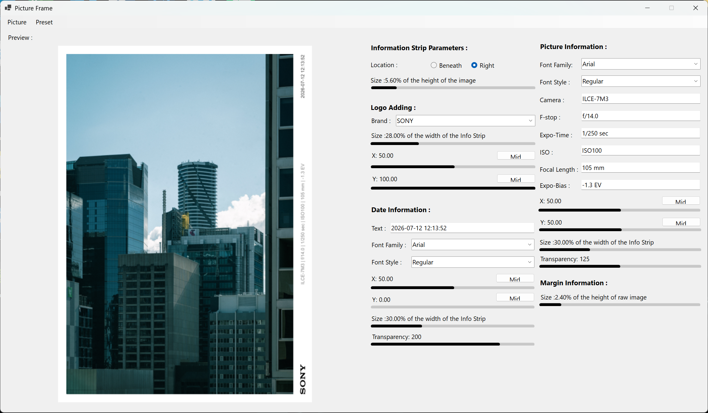

# PictureFrame

[English](#english) | [简体中文](#简体中文)

<a id="english"></a>
## English

### Overview

**PictureFrame** is a Windows Forms desktop application for adding a photographic information strip and optional white margins to JPEG photographs. It reads selected EXIF metadata, lets the user adjust the layout and typography, previews the result, and exports the rendered image. It also provides JSON-based style presets and three batch-processing modes.

The application was originally built as a personal learning project with Windows Forms. This README describes the behavior implemented in the source code included in this repository; it does not imply that every edge case has been exhaustively tested.

### Demonstration / 演示截图

<p align="center">
  
</p>

### Features

#### 1. Open a photograph and read EXIF metadata

1. Start the application.
2. Select **Picture → Open Picture**.
3. Choose one `.jpg` file.
4. The application displays a preview and attempts to read the following EXIF fields:

   | EXIF information | Display field |
   | --- | --- |
   | Camera model (`Model`) | Camera |
   | Original capture date/time (`Date/Time Original`) | Date |
   | Aperture (`F-Number`) | F-stop |
   | Shutter speed (`Shutter Speed Value`) | Expo-Time |
   | ISO (`ISO Speed Ratings`) | ISO |
   | Focal length (`Focal Length`) | Focal Length |
   | Exposure compensation (`Exposure Bias Value`) | Expo-Bias |
   | Camera manufacturer (`Make`) | Used to identify a supported logo |

   The capture date is reformatted for display. The metadata text fields can also be edited manually before saving.

   When a photograph is opened, the initial frame layout is also selected from its height-to-width ratio: landscape images use `Horizontal_Flex`, near-square images use `Square_Flex`, portrait images up to a height/width ratio of 1.45 use `Vertical_Flex`, and taller portrait images use `Vertical_Flex_Right`.

   The automatic logo lookup recognizes Sony, Nikon, and Canon manufacturer values. The logo selector also offers these three brands. Other manufacturers do not have a built-in logo mapping.

#### 2. Customize the frame and information strip

The controls beside the preview let you adjust the following properties:

- **Information strip location:** place the strip beneath the photograph or on its right side.
- **Information strip size:** change the strip width/height relative to the photograph. The strip is drawn in white.
- **Camera logo:** select a supported brand, then adjust its size and its X/Y position. The **Mid** buttons provide quick centering for the corresponding axis.
- **Date information:** edit the displayed date text; select a font family installed on the current Windows machine; select an available font style; and adjust its X/Y position, size, and transparency.
- **Picture information:** edit the camera and exposure text fields; select a font family and available font style; and adjust its X/Y position, size, and transparency.
- **Margin size:** add a white outer margin around the composition.

Position controls use normalized values (shown as percentages in the interface). Text size is expressed relative to the information-strip dimension. Text transparency uses the range 0–255; higher values produce more opaque text.

The font-family lists are populated from fonts installed on the computer. The available font styles depend on the selected font family.

#### 3. Save one framed photograph

1. Open a `.jpg` photograph and adjust the layout.
2. Select **Picture → Save Picture**.
3. Choose the destination and filename in the save dialog.
4. The suggested filename adds `(framed)` before the `.jpg` extension.

The final image is rendered from the original loaded bitmap rather than the 900-pixel preview bitmap. The information strip and margin can increase the output canvas dimensions.

#### 4. Batch processing

All three batch commands allow multiple `.jpg` files to be selected. Each processed file is saved in its source directory with `(framed)` appended to the original filename.

| Menu command | Implemented behavior |
| --- | --- |
| **Picture → Batch Apply (Automative)** | Opens each selected image and automatically chooses a built-in layout based on its height-to-width ratio. The selected layout is one of `Horizontal_Flex`, `Square_Flex`, `Vertical_Flex`, or `Vertical_Flex_Right`. The image's EXIF information is then used to populate the date, exposure text, and supported camera logo. |
| **Picture → Batch Apply (Only Margin)** | Applies the built-in `Just_Margin` preset to each selected image. It adds the preset's blank strip and white margin without drawing date text, exposure text, or a logo. |
| **Picture → Batch Apply (Only Compression)** | Applies the built-in `Nothing` preset and saves the image without adding an information strip or margin. The menu command does not expose a user-adjustable JPEG quality/compression setting. |

**Important:** `Batch Apply (Automative)` does not simply reuse the complete custom layout currently visible in the editor. Each image is initialized with an aspect-ratio-based built-in layout. Use the single-image save workflow when you need to retain a manually customized composition.

The batch dialog is filtered to `.jpg` files. The code does not contain a batch rule that skips a file solely because its EXIF metadata is incomplete; metadata fields that cannot be read are not newly populated from that file.

#### 5. Save and load custom presets

- Select **Preset → Save Preset** to save the current layout settings as a `.json` file.
- Select **Preset → Open Preset** to load a previously saved `.json` preset.
- Select **Preset → Use Primary Preset** to apply one of the seven presets bundled with the application.

The bundled presets are:

1. `Horizontal | MidAlign`
2. `Horizontal | Flex`
3. `Square | Flex`
4. `Vertical | Flex`
5. `Vertical | Flex (Right)`
6. `Just Margin`
7. `Nothing`

A preset stores layout and appearance parameters such as strip location and size, logo size and position, date/text font settings, text positions and transparency, and margin size. It does **not** store the photograph-specific EXIF values, the date string, the exposure-information text, or the selected camera brand/logo index. Those values are populated or selected separately for each photograph.

### Interface behavior and notes

- When the application first starts, **Open Picture** is the only enabled image-editing operation. Other editing, saving, batch, and preset operations become available after an image has been opened.
- The preview bitmap is resized so that its longest edge is 900 pixels. This is for preview responsiveness; the final save path uses the original loaded image bitmap.
- Input selection is configured for `.jpg` files.
- The final output is encoded as a new JPEG using the .NET image API. It is therefore a JPEG re-encode, not a byte-for-byte copy or a lossless metadata-preserving export. The code does not explicitly write the original EXIF metadata back to the output file, and it does not expose a JPEG quality control.
- If an image does not contain a particular EXIF tag, that value cannot be automatically extracted. The current code does not explicitly clear every text field when a new image is opened, so a field can retain a value from the previously opened image. Check and correct the editable metadata fields before processing images with incomplete metadata.
- The batch output is written beside each source image. For example, `photo.jpg` becomes `photo(framed).jpg`.

### Build and run

#### Requirements

- Windows (the project uses Windows Forms).
- .NET 6 SDK / Windows Desktop targeting support.
- Visual Studio 2022 with the .NET desktop development workload, or the .NET CLI.

The project targets `net6.0-windows` and enables Windows Forms in `PictureFrame.csproj`.

#### Build with Visual Studio

1. Open `PictureFrame.sln` in Visual Studio.
2. Allow NuGet package restore to complete.
3. Select the `PictureFrame` project as the startup project.
4. Build and run the project.

#### Build with the .NET CLI

Run these commands from the repository root:

```bash
dotnet restore PictureFrame.sln
dotnet build PictureFrame.sln --configuration Release
dotnet run --project PictureFrame/PictureFrame.csproj
```

#### NuGet packages declared by the project

| Package | Version |
| --- | ---: |
| Costura.Fody | 5.7.0 |
| DeepCloner | 0.10.4 |
| Fody | 6.8.0 |
| Magick.NET-Q16-AnyCPU | 13.4.0 |
| MetadataExtractor | 2.8.1 |
| Newtonsoft.Json | 13.0.3 |

### Project structure

```text
PictureFrame/
├── PictureFrame.sln
└── PictureFrame/
    ├── PictureFrame.csproj
    ├── Program.cs
    ├── Mainform.cs
    ├── Mainform.Designer.cs
    ├── Mainform.resx
    ├── PictureFunctions.cs
    ├── PreviewGeneClass.cs
    ├── JSONinteraction.cs
    ├── ControlBar.cs
    ├── ControlBarEventArgs.cs
    ├── BarRangeStruct.cs
    ├── JPGInfoStruct.cs
    ├── Enums.cs
    ├── FontFunctions.cs
    ├── ProgressShower.cs
    ├── ProgressShower.Designer.cs
    ├── ProgressShower.resx
    ├── FodyWeavers.xml
    ├── FodyWeavers.xsd
    ├── Properties/
    │   ├── Resources.resx
    │   ├── Resources.Designer.cs
    │   ├── Settings.settings
    │   ├── Settings.Designer.cs
    │   └── launchSettings.json
    └── Resources/
        ├── *.json
        ├── logo_Canon.png
        ├── logo_Nikon.png
        └── logo_Sony.png
```

Main implementation areas:

- `Mainform.cs`: main window behavior, editor controls, menu actions, and batch workflows.
- `PictureFunctions.cs`: EXIF reading, bitmap composition, logo/text drawing, margins, and JPEG output.
- `PreviewGeneClass.cs`: the image and style parameters used to generate the preview and final image. It selects a default bundled layout from the image aspect ratio when initialized.
- `JSONinteraction.cs`: serialization and deserialization of preset parameters.
- `ControlBar.cs`: the custom-drawn slider control used by the editor.
- `Resources/` and `Properties/Resources.resx`: bundled preset JSON files and camera-logo images.

**Keep the `Resources/` files and `Properties/Resources.resx` in version control.** The resource file references the JSON and PNG files by relative path, and the project uses them when building the application.

### Git ignore policy

The repository `.gitignore` excludes generated `bin/` and `obj/` folders, Visual Studio workspace/user files, test output, generated NuGet packages, and operating-system clutter. It intentionally does not ignore source files, `.sln`/`.csproj` files, `launchSettings.json`, `.resx` files, JSON presets, or image resources.

---

<a id="简体中文"></a>
## 简体中文

### 项目简介

**PictureFrame** 是一个基于 Windows Forms 的 Windows 桌面程序，用于给 JPEG 照片添加摄影信息展示栏和可选的白色留白边框。程序可以读取照片中的 EXIF 信息，允许用户调整图框布局、Logo、文字样式与位置，并预览、导出处理后的图片。此外，程序支持 JSON 样式预设和三种批量处理模式。

本项目最初是一个用于自学 Windows Forms 的个人项目。以下说明以本仓库当前提供的源代码为依据，不代表所有边缘情况都经过完整测试。

### 功能介绍

#### 1. 打开照片并读取 EXIF 信息

1. 启动程序。
2. 选择 **Picture → Open Picture**。
3. 选择一张 `.jpg` 图片。
4. 程序会显示预览，并尝试读取以下 EXIF 字段：

   | EXIF 信息 | 对应界面字段 |
   | --- | --- |
   | 相机型号（`Model`） | Camera |
   | 原始拍摄日期/时间（`Date/Time Original`） | Date |
   | 光圈（`F-Number`） | F-stop |
   | 快门速度（`Shutter Speed Value`） | Expo-Time |
   | 感光度（`ISO Speed Ratings`） | ISO |
   | 焦距（`Focal Length`） | Focal Length |
   | 曝光补偿（`Exposure Bias Value`） | Expo-Bias |
   | 相机制造商（`Make`） | 用于识别可用的品牌 Logo |

   拍摄日期会经过格式转换后显示。日期和摄影参数对应的文本框也可以手动编辑。

   图片打开时，程序还会根据高宽比自动选择初始图框布局：横向图片使用 `Horizontal_Flex`，接近正方形的图片使用 `Square_Flex`，高宽比不超过 1.45 的竖向图片使用 `Vertical_Flex`，更高的竖向图片使用 `Vertical_Flex_Right`。

   自动 Logo 识别目前对应 Sony、Nikon 和 Canon。Logo 选择框也提供这三个品牌；其他制造商没有内置的 Logo 映射。

#### 2. 自定义图框与信息栏

预览区域旁边的控件可以调整以下参数：

- **Information strip location：** 将信息栏放在照片下方（Beneath）或右侧（Right）。
- **Information strip size：** 调整信息栏尺寸。信息栏以白色画布绘制，其尺寸根据照片尺寸按比例计算。
- **Camera logo：** 选择支持的相机品牌，调整 Logo 大小及 X/Y 位置；对应的 **Mid** 按钮可以快速将 Logo 在相应方向居中。
- **Date information：** 编辑日期文本，选择本机已安装的字体和可用字体样式，并调整 X/Y 位置、字号和透明度。
- **Picture information：** 编辑相机型号及曝光参数文本，设置字体、字体样式、X/Y 位置、字号和透明度。
- **Margin size：** 在合成后的图片外围添加白色留白边框。

位置参数使用归一化坐标，界面以百分比显示。文字尺寸以信息栏对应尺寸为基准。文字透明度范围为 0–255，数值越大，文字越不透明。

字体列表来自当前 Windows 系统已安装的字体；不同字体支持的字体样式可能不同，程序会根据所选字体更新可用样式。

#### 3. 保存单张处理后的照片

1. 打开一张 `.jpg` 照片并调整图框样式。
2. 选择 **Picture → Save Picture**。
3. 在保存窗口中选择输出路径和文件名。
4. 默认文件名会在原文件名后添加 `(framed)`，并保留 `.jpg` 扩展名。

最终图片使用原始载入的 Bitmap 进行绘制，而不是用于界面显示的 900 像素预览图。因此，新增的信息栏和留白边框可能会增加最终画布尺寸。

#### 4. 批量处理

三种批量处理命令都允许一次选择多张 `.jpg` 图片。处理后的图片保存在各自源文件所在目录，文件名追加 `(framed)`。

| 菜单命令 | 实际实现行为 |
| --- | --- |
| **Picture → Batch Apply (Automative)** | 逐张打开图片，根据图片的高宽比自动选择内置布局：`Horizontal_Flex`、`Square_Flex`、`Vertical_Flex` 或 `Vertical_Flex_Right`。随后读取该图片的 EXIF 信息，填充日期、摄影参数以及可识别的相机 Logo。 |
| **Picture → Batch Apply (Only Margin)** | 对每张图片应用内置的 `Just_Margin` 预设。该预设会添加空白信息区域和白色留白边框，不绘制日期、摄影参数文字或相机 Logo。 |
| **Picture → Batch Apply (Only Compression)** | 对每张图片应用内置的 `Nothing` 预设，不添加信息栏和留白边框，然后保存为 JPEG。该菜单项没有提供可调节的 JPEG 质量或压缩率参数。 |

**重要说明：** `Batch Apply (Automative)` 并不是直接复用编辑器中当前手动调整的完整图框样式。每张图片打开时，程序都会根据其高宽比初始化一个内置布局。如果需要精确保留手动调整的构图，请使用单张图片的保存流程。

批量文件选择窗口仅筛选 `.jpg` 文件。源码中没有“只要 EXIF 不完整就跳过整张图片”的批处理判断；无法读取的 EXIF 字段不会从该图片中重新填充。

#### 5. 保存、加载和调用预设

- 选择 **Preset → Save Preset**，将当前布局参数保存为 `.json` 文件。
- 选择 **Preset → Open Preset**，从已有 `.json` 文件加载布局参数。
- 选择 **Preset → Use Primary Preset**，调用程序内置的七种预设之一。

当前内置预设共七种：

1. `Horizontal | MidAlign`
2. `Horizontal | Flex`
3. `Square | Flex`
4. `Vertical | Flex`
5. `Vertical | Flex (Right)`
6. `Just Margin`
7. `Nothing`

预设保存的是布局和外观参数，例如信息栏位置与尺寸、Logo 大小与位置、日期和摄影信息文字的字体设置、文字位置与透明度，以及外框尺寸。预设**不会保存**照片本身的 EXIF 数值、日期文本、摄影参数文本或当前选择的相机品牌 Logo 编号。这些内容需要针对每张照片单独读取或选择。

### 界面行为与注意事项

- 程序启动时，只有 **Open Picture** 可用。打开图片后，其他编辑、保存、批处理和预设操作才会启用。
- 为了提高预览调整时的响应速度，界面预览图会将长边缩放到 900 像素。最终保存时使用的是原始载入图片。
- 图片选择器目前配置为读取 `.jpg` 文件。
- 最终文件会通过 .NET 图像 API 重新编码为 JPEG，并非逐字节复制原图，也不是保证无损且保留元数据的导出。源码没有显式将原始 EXIF 信息写回输出文件，也没有提供 JPEG 质量调节选项。
- 如果图片缺少某个 EXIF 字段，对应信息就无法从该字段自动提取。当前代码不会在每次打开新图片时显式清空所有文本框，因此字段可能保留上一张图片的内容。处理 EXIF 不完整的图片前，建议检查并修正可编辑的信息文本框。
- 批处理结果保存在源图片同一目录。例如 `photo.jpg` 会生成 `photo(framed).jpg`。

### 构建与运行

#### 环境要求

- Windows（项目使用 Windows Forms）。
- .NET 6 SDK / Windows Desktop 目标框架支持。
- Visual Studio 2022（安装 .NET 桌面开发工作负载），或 .NET CLI。

项目文件 `PictureFrame.csproj` 的目标框架为 `net6.0-windows`，并启用了 Windows Forms。

#### 使用 Visual Studio

1. 使用 Visual Studio 打开 `PictureFrame.sln`。
2. 等待 NuGet 还原依赖包。
3. 将 `PictureFrame` 项目设置为启动项目。
4. 构建并运行。

#### 使用 .NET CLI

在仓库根目录运行：

```bash
dotnet restore PictureFrame.sln
dotnet build PictureFrame.sln --configuration Release
dotnet run --project PictureFrame/PictureFrame.csproj
```

#### 项目声明的 NuGet 依赖

| Package | Version |
| --- | ---: |
| Costura.Fody | 5.7.0 |
| DeepCloner | 0.10.4 |
| Fody | 6.8.0 |
| Magick.NET-Q16-AnyCPU | 13.4.0 |
| MetadataExtractor | 2.8.1 |
| Newtonsoft.Json | 13.0.3 |

### 项目结构

```text
PictureFrame/
├── PictureFrame.sln
└── PictureFrame/
    ├── PictureFrame.csproj
    ├── Program.cs
    ├── Mainform.cs
    ├── Mainform.Designer.cs
    ├── Mainform.resx
    ├── PictureFunctions.cs
    ├── PreviewGeneClass.cs
    ├── JSONinteraction.cs
    ├── ControlBar.cs
    ├── ControlBarEventArgs.cs
    ├── BarRangeStruct.cs
    ├── JPGInfoStruct.cs
    ├── Enums.cs
    ├── FontFunctions.cs
    ├── ProgressShower.cs
    ├── ProgressShower.Designer.cs
    ├── ProgressShower.resx
    ├── FodyWeavers.xml
    ├── FodyWeavers.xsd
    ├── Properties/
    │   ├── Resources.resx
    │   ├── Resources.Designer.cs
    │   ├── Settings.settings
    │   ├── Settings.Designer.cs
    │   └── launchSettings.json
    └── Resources/
        ├── *.json
        ├── logo_Canon.png
        ├── logo_Nikon.png
        └── logo_Sony.png
```

主要代码文件：

- `Mainform.cs`：主窗体逻辑、编辑控件、菜单操作和批处理流程。
- `PictureFunctions.cs`：EXIF 读取、Bitmap 合成、Logo/文字绘制、留白边框和 JPEG 输出。
- `PreviewGeneClass.cs`：预览及最终图片生成所需的图片和样式参数；初始化时会根据图片高宽比选择默认内置布局。
- `JSONinteraction.cs`：预设参数的 JSON 序列化与反序列化。
- `ControlBar.cs`：编辑界面使用的自绘滑动条控件。
- `Resources/` 与 `Properties/Resources.resx`：内置预设 JSON 文件和相机品牌 Logo 图片资源。

**请将 `Resources/` 目录及 `Properties/Resources.resx` 保留在 Git 仓库中。** `.resx` 文件通过相对路径引用 JSON 和 PNG 文件，项目构建时会使用这些资源。

### Git 忽略规则

仓库中的 `.gitignore` 用于排除自动生成的 `bin/`、`obj/`、Visual Studio 工作区及用户配置、测试输出、NuGet 生成包和操作系统杂项文件。它不会忽略源代码、`.sln` / `.csproj`、`launchSettings.json`、`.resx`、JSON 预设或图片资源。
